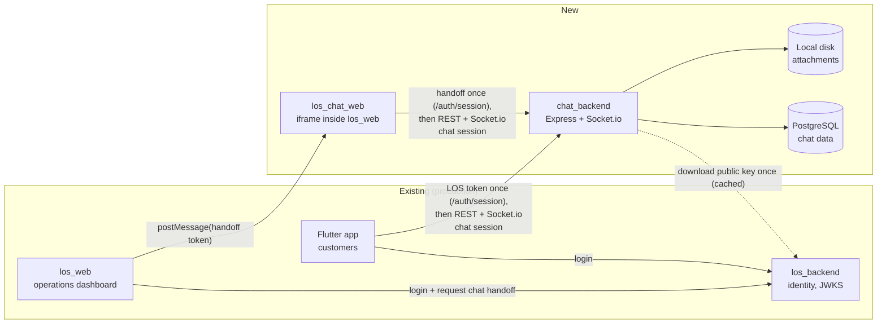
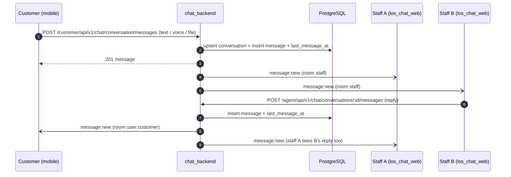
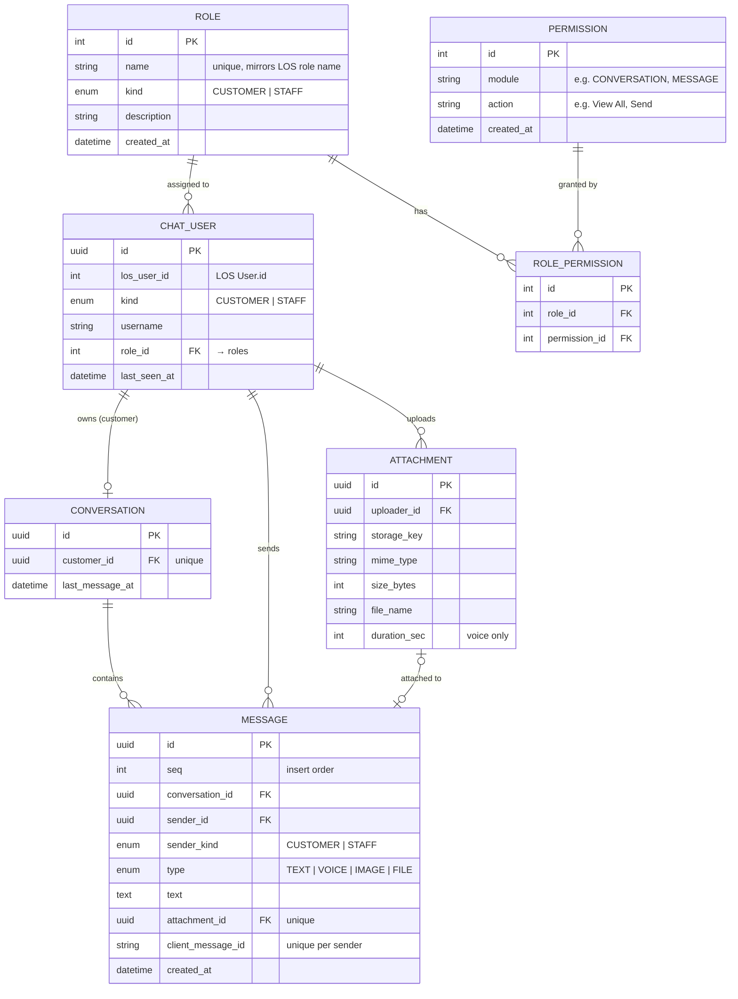

# chat_backend: step 1 (chat working end to end)

## Context

The production system has three parts: `los_backend` (identity, staff, customers), the Flutter customer app (chat was mock UI only) and `los_web` (operations). None of them had chat. `chat_backend` is a standalone service that serves:
- the **Flutter app**, where customers chat, and
- **los_chat_web** (another repo), embedded as an iframe in `los_web`, where LOS staff answer.

Step 1 is about making chat itself work:
1. A customer sends a message: text, voice, an image or a file. Links are just text.
2. **Every LOS staff member** sees every conversation and all its messages.
3. **Any staff member replies** directly. Nobody assigns or picks up a conversation.

Tickets (open box, assignment, Start/Finish, KPI events) were designed and built first, then removed on 2026-11-06 so chat works first. That design is parked in [parked/tickets.md](parked/tickets.md).

Not in step 1: tickets/assignment, read receipts, reply-to, reactions, push notifications, LOS revocation checks.

## Sign in with LOS

LOS is the identity provider: it alone checks passwords. chat_backend verifies an LOS-signed RS256 token with the LOS JWKS, maps the person to `chat_users` (find-or-create by LOS user id), and issues **its own session**. LOS tokens are accepted only by the two `/auth/session` endpoints. Full spec for the LOS team and the apps: [auth/los-chat-handoff.md](auth/los-chat-handoff.md).

```
Mobile:  LOS app login ─▶ LOS access token ─▶ POST /customer/api/v1/auth/session { losToken }   ─▶ customer session (1 h)
Web:     los_web ─▶ los_backend: chat handoff (2 min, aud chat) ─postMessage─▶ los_chat_web
              ─▶ POST /agent/api/v1/auth/session { handoffToken }                         ─▶ staff session (15 min)
Then:    every chat REST call and the socket use the chat session
```

- Any LOS staff role may use chat; the role is stored in `chat_users.los_role` for display only.
- Sessions use one audience per kind, so a customer session doesn't work on staff routes and vice versa.

## Diagrams

### D1. System context


### D2. A message and a reply


### D3. Data model


## Tables

All ids are UUIDs and times are `timestamptz`. Chat history is permanent, so every foreign key is `ON DELETE RESTRICT`.

| Enum | Values |
| :--- | :--- |
| `chat_user_kind` | `CUSTOMER`, `STAFF` |
| `sender_kind` | `CUSTOMER`, `STAFF` |
| `message_type` | `TEXT`, `VOICE`, `IMAGE`, `FILE` |

**`roles`**: known roles — mirrors LOS role names; seeded at migration time

| Column | Type | Null | Key / constraint | Notes |
| :--- | :--- | :--- | :--- | :--- |
| `id` | int | no | PK, autoincrement | |
| `name` | varchar | no | unique | mirrors LOS role name exactly (e.g. `CREDIT_ASSESSMENT`) |
| `kind` | chat_user_kind | no | | `CUSTOMER` or `STAFF` |
| `description` | varchar | yes | | |
| `created_at` | timestamptz | no | | |

**`permissions`**: static chat permission pairs; seeded, never managed via API

| Column | Type | Null | Key / constraint | Notes |
| :--- | :--- | :--- | :--- | :--- |
| `id` | int | no | PK, autoincrement | |
| `module` | varchar | no | unique with `action` | e.g. `CONVERSATION`, `MESSAGE`, `ATTACHMENT` |
| `action` | varchar | no | unique with `module` | e.g. `View All`, `Send`, `Download` |
| `created_at` | timestamptz | no | | |

**`role_permissions`**: which permissions are attached to which role

| Column | Type | Null | Key / constraint | Notes |
| :--- | :--- | :--- | :--- | :--- |
| `id` | int | no | PK, autoincrement | |
| `role_id` | int | no | FK → `roles.id`, unique with `permission_id` | |
| `permission_id` | int | no | FK → `permissions.id`, unique with `role_id` | |

**`chat_users`**: everyone who has used chat, keyed by their LOS identity

| Column | Type | Null | Key / constraint | Notes |
| :--- | :--- | :--- | :--- | :--- |
| `id` | uuid | no | PK | |
| `los_user_id` | int | no | unique with `kind` | `userId` from the LOS token |
| `kind` | chat_user_kind | no | unique with `los_user_id` | |
| `username` | varchar | no | | copied from the token, refreshed on each sign-in |
| `role_id` | int | no | FK → `roles.id` | resolved and validated at session exchange time |
| `last_seen_at` | timestamptz | no | | |
| `created_at` / `updated_at` | timestamptz | no | | |

**`conversations`**: one permanent thread per customer

| Column | Type | Null | Key / constraint | Notes |
| :--- | :--- | :--- | :--- | :--- |
| `id` | uuid | no | PK | |
| `customer_id` | uuid | no | FK → `chat_users.id`, **unique** | one conversation per customer |
| `last_message_at` | timestamptz | yes | index | staff inbox order; null until the first message |
| `created_at` | timestamptz | no | | |

**`messages`**

| Column | Type | Null | Key / constraint | Notes |
| :--- | :--- | :--- | :--- | :--- |
| `id` | uuid | no | PK | also the paging cursor (`?before=`) |
| `seq` | int | no | unique, auto-increment | insert order; history is sorted by it |
| `conversation_id` | uuid | no | FK → `conversations.id`, index with `seq` | |
| `sender_id` | uuid | no | FK → `chat_users.id` | the customer or a staff member |
| `sender_kind` | sender_kind | no | | |
| `type` | message_type | no | | |
| `text` | text | yes | | required for TEXT; optional caption on files |
| `attachment_id` | uuid | yes | FK → `attachments.id`, **unique** | required for VOICE, IMAGE and FILE |
| `client_message_id` | varchar | yes | unique with `sender_id` | made by the app; a retried send returns the original |
| `created_at` | timestamptz | no | | |

**`attachments`**: uploaded first, then sent in a message

| Column | Type | Null | Key / constraint | Notes |
| :--- | :--- | :--- | :--- | :--- |
| `id` | uuid | no | PK | |
| `uploader_id` | uuid | no | FK → `chat_users.id` | only the uploader can send it, once |
| `storage_key` | varchar | no | unique | path in storage; never sent to the apps |
| `mime_type` | varchar | no | | images, m4a/aac/mp3 audio, pdf, Word, Excel |
| `size_bytes` | int | no | | up to 20 MB by default |
| `file_name` | varchar | no | | original name |
| `duration_sec` | int | yes | | voice only |
| `created_at` | timestamptz | no | | |

**Relationships**

| Child | Column | Parent | Parent : child | Meaning |
| :--- | :--- | :--- | :--- | :--- |
| `conversations` | `customer_id` | `chat_users` | 1 : 0..1 | each customer's single thread |
| `messages` | `conversation_id` | `conversations` | 1 : N | the history |
| `messages` | `sender_id` | `chat_users` | 1 : N | who wrote it |
| `messages` | `attachment_id` | `attachments` | 1 : 0..1 | a file belongs to at most one message |
| `attachments` | `uploader_id` | `chat_users` | 1 : N | who uploaded it |

## API

| Audience | Method | Path | What it does |
| :--- | :--- | :--- | :--- |
| customer | POST | `/customer/api/v1/auth/session` | `{ losToken }` → chat session |
| customer | GET | `/customer/api/v1/chat/conversation` | the customer's thread (created on first call) |
| customer | GET | `/customer/api/v1/chat/conversation/messages?before=&size=` | history, newest first |
| customer | POST | `/customer/api/v1/chat/conversation/messages` | send `{ clientMessageId, type, text?, attachmentId? }` |
| staff | POST | `/agent/api/v1/auth/session` | `{ handoffToken }` → chat session |
| staff | GET | `/agent/api/v1/chat/conversations?page=&size=` | every conversation, latest activity first, with `customer` and `lastMessage` |
| staff | GET | `/agent/api/v1/chat/conversations/:id` | one conversation |
| staff | GET | `/agent/api/v1/chat/conversations/:id/messages?before=&size=` | its history |
| staff | POST | `/agent/api/v1/chat/conversations/:id/messages` | reply, any staff member |
| both | POST / GET | `…/chat/attachments`, `…/chat/attachments/:id` | upload (multipart `file`, `durationSec` for voice) / download |

Socket.io (same chat session token): `message:new` goes to the customer's room and to every staff member; `typing` goes both ways.

## Code

- `src/modules/auth/`: the two exchanges and `verifySession`.
- `src/modules/chat/shared/`:
  - `ConversationRepository` (conversations and messages) and `AttachmentRepository`
  - `MessageService`: one send path for both audiences (idempotency, attachment check, insert, `last_message_at`, `message:new`)
  - `AttachmentService`, `chat-events`
- `src/modules/chat/customer-chat/` and `staff-chat/`: the two audiences.
- `src/modules/chat/realtime/`: socket handshake and typing.

## Verification

- `pnpm run typecheck`: 0 errors.
- Postman: `postman/chat_backend_los_dev.postman_collection.json` runs the flow against real LOS dev logins (customer and staff sign-in, message and PDF, staff inbox, history, download, reply). Before it was removed, a dev-key suite of 54 requests and 135 assertions passed against this build.
- `pnpm run smoke:socket`: 10/10. Covers handshake rejections, `message:new` to both staff members and the customer, a staff reply reaching the customer and the other staff member, and typing both ways.

## History

- **2026-11-05:** milestone 1 with tickets ([parked/tickets.md](parked/tickets.md)).
- **2026-11-06:**
  - **Auth v2:** customers exchange the LOS token once for a chat session.
  - **Tickets removed:** migration `20261106090000_remove_tickets` dropped `tickets`, `ticket_events`, `messages.ticket_id`, `chat_users.staff_role` and the ticket SYSTEM messages.
