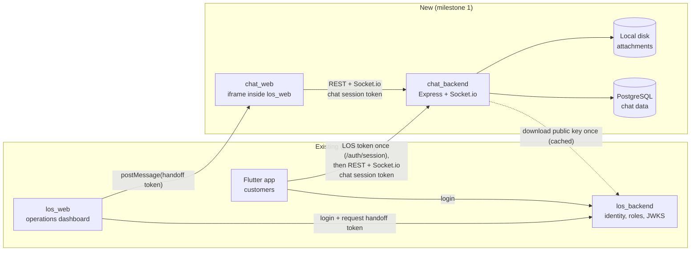
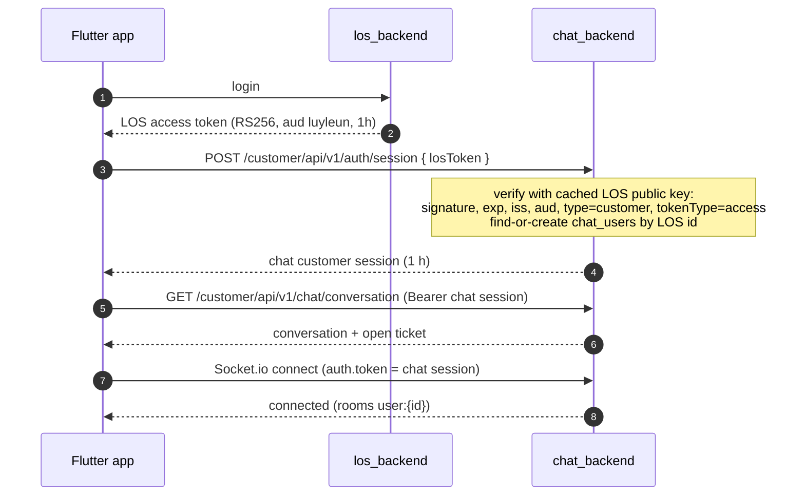
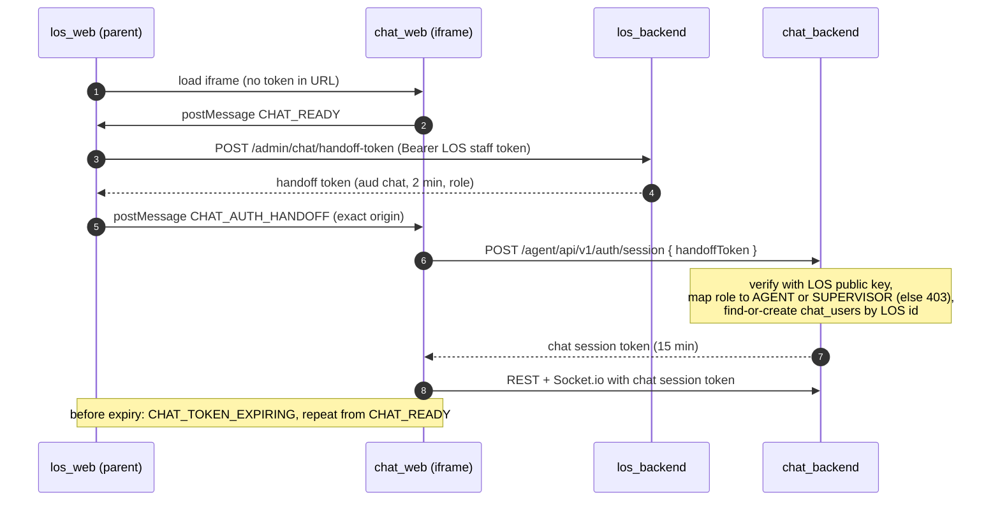
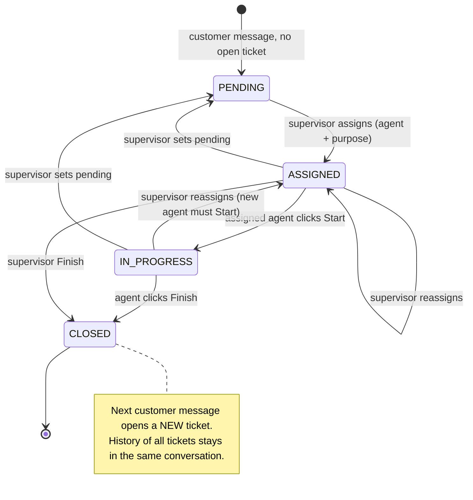
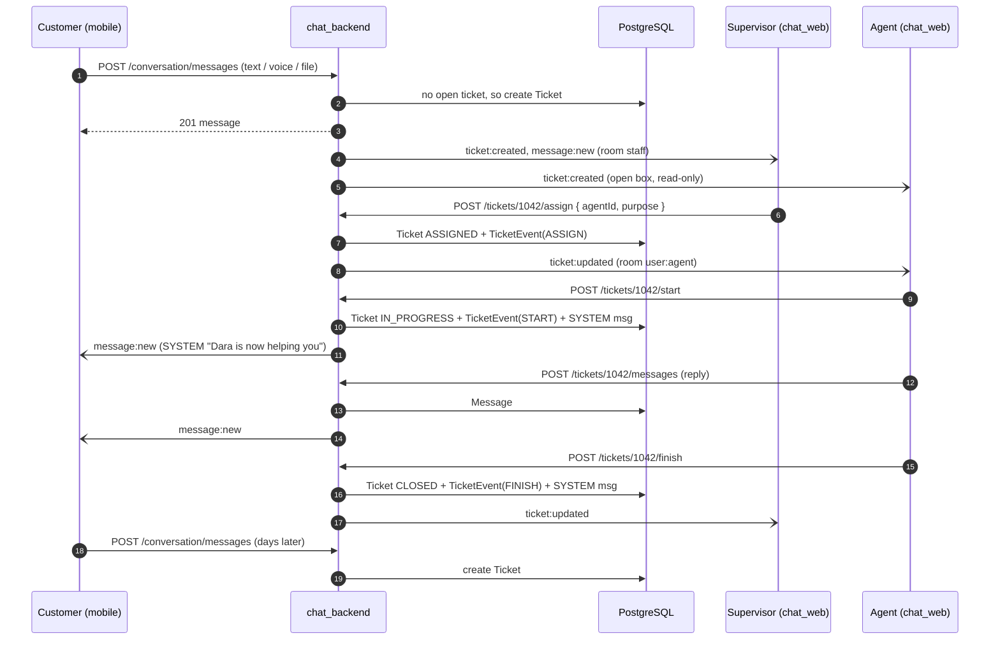
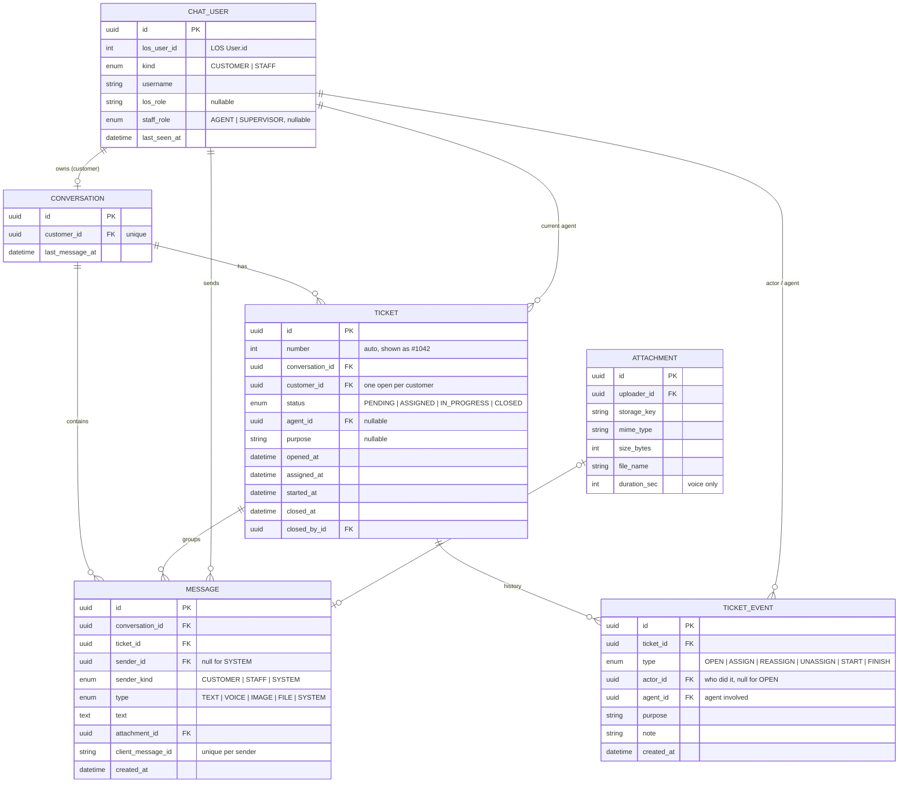
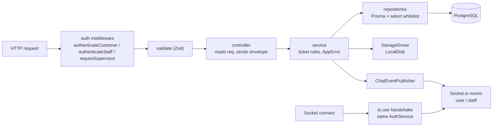

> **Parked (2026-11-06).** Tickets, assignment and the agent/supervisor split were removed so chat works first: every LOS staff member now reads and replies to every conversation. This is the ticket design as it was built, kept for when tickets come back. Migration `20261106090000_remove_tickets` dropped its tables; the current design is in [../milestone_1.md](../milestone_1.md).

# chat_backend milestone 1 (tickets, open box, customer messages)

## Context

The production system has three parts: `los_backend` (identity, staff roles, customers), the Flutter customer app (chat is mock UI only) and `los_web` (operations). None of them has chat. `chat_backend` is a new standalone service. It serves:
- the Flutter app (customers), and
- a new `chat_web` (another repo), embedded as an iframe in `los_web` and used by customer-support agents and their supervisor.

This repo currently has local email/password auth and a sample `posts` module. Both are removed: identity comes from LOS tokens.

### Milestone 1 scope (from the user)
1. **Open box.**
   - Every agent and the supervisor see incoming chats.
   - **Agents can't pick up from the open box.** A ticket reaches an agent only when the **supervisor assigns** it, choosing the agent and the issue's purpose.
   - The supervisor can also **reassign** a ticket or set it back to **pending**.
   - Every assignment is recorded so work can be counted per agent for the KPI.
   - Being assigned isn't the same as working on it: the assigned agent clicks **Start** (→ IN_PROGRESS) to pick the ticket up, and only then can reply.
   - The assigned agent clicks **Finish**, which closes the ticket.
   - The customer's next message opens a **new ticket**.
   - The full history across tickets is always visible to whoever handles the customer next.
2. **Customer messages:** text (links are just text), voice, and attachments (pdf, documents, images). Agents reply with text and attachments too.

Deferred to a later milestone: reply-to, reactions, read receipts, push notifications, KPI report endpoints (the data is recorded now), and LOS Redis revocation checks.

### Decisions confirmed
- **Identity ("Sign in with LOS"):** verify LOS RS256 tokens with the LOS public key (JWKS), map the person to `chat_users` (find-or-create by LOS id), and issue chat_backend's own session. See [Auth v2](#auth-v2-2026-11-06-chat-owned-sessions).
  - Mobile exchanges its LOS customer access token once at `POST /customer/api/v1/auth/session` for a 1-hour customer session.
  - chat_web gets a chat-only LOS **handoff token** through los_web's `postMessage` and exchanges it at `POST /agent/api/v1/auth/session` for a 15-minute staff session.
- **Staff levels:** LOS role names are mapped through config, `CHAT_AGENT_ROLES` and `CHAT_SUPERVISOR_ROLES`.
- **Visibility:** every agent sees every ticket and its history read-only; only the assigned agent can reply.
- **Pending / reassign:** supervisor only. Agents can't release a ticket.
- **Attachments:** local disk behind a storage interface. A cloud driver can be added later.
- **Old code:** remove the local auth and the posts module.

### LOS facts (from `../los_backendv2`, and the JWKS confirmed live)
- JWKS: `https://api.los.delightech.asia/api/v1/guest/.well-known/jwks.json` publishes one RSA key, `kid 93ceecd4d00c47d7`. LOS access tokens carry no `kid`, which is fine with one key.
- Customer access token: `{ userId:number, username, type:'customer', tokenType:'access', iss:'los-backend', aud:'luyleun' }`.
- Staff tokens carry `role` (one role name) and `roleId`.
- LOS ids are `Int`.
- **Change needed in los_backend (LOS team):** the handoff endpoint (`dashboard-embed`, `jwt.util.ts:142-160`) must be able to issue `aud:'chat'` with `tokenType:'chat-handoff'`. Until then, local development uses a dev key pair and a token script.

## Domain model

```
Customer ──1:1── Conversation (one thread per customer, forever: holds ALL messages)
                     │
                     ├──1:N── Ticket (#1042, #1057, ...; at most ONE open per customer)
                     │          status: PENDING → ASSIGNED → IN_PROGRESS → CLOSED
                     │          agentId (current), purpose, openedAt, assignedAt, startedAt, closedAt, closedById
                     │          └──1:N── TicketEvent (every change: OPEN, ASSIGN, REASSIGN, UNASSIGN, START, FINISH)
                     │
                     └──1:N── Message (conversationId + ticketId), plus optional Attachment
```

- **Ticket lifecycle:**
  - The customer sends a message and has no open ticket → a new ticket is created with status **PENDING** and appears in the open box.
  - **Assign / reassign (supervisor only):** the supervisor sets `agentId` and `purpose` (both required) → **ASSIGNED**. Recorded as `ASSIGN` or `REASSIGN`. Agents can't take tickets themselves.
  - **Conflicting changes:** a ticket update checks that the ticket hasn't changed in the meantime (e.g. it was already closed), otherwise 409.
  - **Start:** only the assigned agent → **IN_PROGRESS**. `startedAt` is saved, the event is recorded as `START`, and a SYSTEM message tells the customer "Dara is now helping you". The agent can only reply while the ticket is IN_PROGRESS.
  - **Reassign** an ASSIGNED or IN_PROGRESS ticket → **ASSIGNED** for the new agent, who must click Start too.
  - **Set pending:** the supervisor clears the agent, from ASSIGNED or IN_PROGRESS → **PENDING**. Recorded as `UNASSIGN`.
  - **Finish:** the assigned agent from IN_PROGRESS, or the supervisor from any open status → **CLOSED**. `closedAt` and `closedById` are saved, and the event is recorded as `FINISH`. The next customer message opens a new ticket.
- **Purpose:** required on every assign and reassign. The supervisor can edit it later.
- **Ticket numbers:** each ticket also gets an auto-increment `number` (shown as `#1042`) next to its UUID.
- **System messages:** ticket events add `SYSTEM` messages to the thread (e.g. "Ticket #1042 opened", "Assigned to Dara", "Closed"), so the history reads clearly for the next agent and for the customer.
- **KPI data:** `TicketEvent` rows give tickets assigned, started and finished per agent per date, time to start (ASSIGN → START) and reassignments. Reports come in a later milestone. The same rows drive the ticket timeline in chat_web.

## Architecture

```
Flutter ── LOS access token ──▶ POST /customer/api/v1/auth/session ──▶ chat customer session (1h) ─┐
los_web ─postMessage(handoff, aud 'chat')─▶ chat_web ─▶ POST /agent/api/v1/auth/session            ├─▶ chat_backend
                                                       ──▶ chat staff session (15m) ───────────────┘
Every chat REST call and the socket use the chat session; LOS tokens only reach /auth/session.
```

- **REST** handles every read and write: validation, the error envelope and service-layer rules stay in one place.
- **Socket.io** only pushes events, plus the `typing` signal.
- Services publish events through an injected `ChatEventPublisher`.
- Socket rooms:
  - `user:{chatUserId}`: everyone
  - `staff`: all agents and the supervisor, for open-box updates and every conversation's messages.

## Diagrams

### D1. System context


### D2. Customer authentication (mobile)


### D3. Staff authentication (chat_web inside los_web)


### D4. Ticket lifecycle


### D5. Main flow: message, assignment, reply, finish


### D6. Data model


### D6b. Database tables (entities, columns, relationships)

All ids are UUIDs, generated by the database. Times are `timestamptz`. Nothing is deleted in milestone 1: chat history is permanent, so every foreign key is `ON DELETE RESTRICT`.

**Enums**

| Enum | Values |
| :--- | :--- |
| `chat_user_kind` | `CUSTOMER`, `STAFF` |
| `staff_role` | `AGENT`, `SUPERVISOR` |
| `ticket_status` | `PENDING`, `ASSIGNED`, `IN_PROGRESS`, `CLOSED` |
| `ticket_event_type` | `OPEN`, `ASSIGN`, `REASSIGN`, `UNASSIGN`, `START`, `FINISH` |
| `sender_kind` | `CUSTOMER`, `STAFF`, `SYSTEM` |
| `message_type` | `TEXT`, `VOICE`, `IMAGE`, `FILE`, `SYSTEM` |

**`chat_users`**: everyone who has used chat (customers and staff), keyed by their LOS identity

| Column | Type | Null | Key / constraint | Notes |
| :--- | :--- | :--- | :--- | :--- |
| `id` | uuid | no | PK | |
| `los_user_id` | int | no | unique with `kind` | `userId` from the LOS token (LOS `User.id`) |
| `kind` | chat_user_kind | no | unique with `los_user_id` | |
| `username` | varchar | no | | copied from the token, refreshed on each login |
| `los_role` | varchar | yes | | LOS role name (staff only), e.g. `CREDIT_SUPPORT_OFFICER` |
| `staff_role` | staff_role | yes | | mapped from `los_role` through config; null for customers |
| `last_seen_at` | timestamptz | no | | |
| `created_at` / `updated_at` | timestamptz | no | | |

**`conversations`**: one permanent thread per customer

| Column | Type | Null | Key / constraint | Notes |
| :--- | :--- | :--- | :--- | :--- |
| `id` | uuid | no | PK | |
| `customer_id` | uuid | no | FK → `chat_users.id`, **unique** | one conversation per customer |
| `last_message_at` | timestamptz | yes | index | sorts lists by most recent activity |
| `created_at` | timestamptz | no | | |

**`tickets`**: one support case inside a conversation

| Column | Type | Null | Key / constraint | Notes |
| :--- | :--- | :--- | :--- | :--- |
| `id` | uuid | no | PK | |
| `number` | int | no | unique, auto-increment | shown to people as `#1042` |
| `conversation_id` | uuid | no | FK → `conversations.id` | |
| `customer_id` | uuid | no | FK → `chat_users.id` | copied from the conversation so the "one open ticket" index works |
| `status` | ticket_status | no | index with `opened_at` | |
| `agent_id` | uuid | yes | FK → `chat_users.id`, index | current agent; null while PENDING |
| `purpose` | text | yes | | set by the supervisor on assign |
| `opened_at` | timestamptz | no | | |
| `assigned_at` | timestamptz | yes | | latest assignment time |
| `started_at` | timestamptz | yes | | when the current agent clicked Start |
| `closed_at` | timestamptz | yes | | |
| `closed_by_id` | uuid | yes | FK → `chat_users.id` | agent or supervisor who clicked Finish |

Partial unique index (raw SQL in the migration): `UNIQUE (customer_id) WHERE status <> 'CLOSED'`, so a customer has at most one open ticket.

**`ticket_events`**: every ticket change, append-only (powers the ticket timeline and the KPI)

| Column | Type | Null | Key / constraint | Notes |
| :--- | :--- | :--- | :--- | :--- |
| `id` | uuid | no | PK | |
| `ticket_id` | uuid | no | FK → `tickets.id`, index with `created_at` | |
| `type` | ticket_event_type | no | | |
| `actor_id` | uuid | yes | FK → `chat_users.id` | who did it (supervisor or agent); null for OPEN |
| `agent_id` | uuid | yes | FK → `chat_users.id`, index with `type`, `created_at` | the agent the event is about (e.g. the new agent on ASSIGN) |
| `purpose` | text | yes | | the purpose at that moment (ASSIGN, REASSIGN) |
| `note` | text | yes | | optional reason, e.g. "Dara on leave" |
| `created_at` | timestamptz | no | | |

**`messages`**: every message in a conversation, each tagged with the ticket it belongs to

| Column | Type | Null | Key / constraint | Notes |
| :--- | :--- | :--- | :--- | :--- |
| `id` | uuid | no | PK | |
| `seq` | int | no | unique, auto-increment | insert order; history is sorted by it (added by the `message_seq` migration) |
| `conversation_id` | uuid | no | FK → `conversations.id`, index with `seq` | history is read by conversation |
| `ticket_id` | uuid | no | FK → `tickets.id`, index | |
| `sender_id` | uuid | yes | FK → `chat_users.id` | null for SYSTEM messages |
| `sender_kind` | sender_kind | no | | |
| `type` | message_type | no | | |
| `text` | text | yes | | required for TEXT and SYSTEM (checked by the service) |
| `attachment_id` | uuid | yes | FK → `attachments.id`, **unique** | required for VOICE/IMAGE/FILE; one attachment belongs to one message |
| `client_message_id` | varchar | yes | unique with `sender_id` | made by the client, so a retried send isn't saved twice |
| `created_at` | timestamptz | no | | |

**`attachments`**: an uploaded file (uploaded first, then sent in a message)

| Column | Type | Null | Key / constraint | Notes |
| :--- | :--- | :--- | :--- | :--- |
| `id` | uuid | no | PK | |
| `uploader_id` | uuid | no | FK → `chat_users.id` | only the uploader can use it before it's attached to a message |
| `storage_key` | varchar | no | unique | path inside `UPLOAD_DIR` (or a bucket key later) |
| `mime_type` | varchar | no | | checked against the allowed list |
| `size_bytes` | int | no | | at most `UPLOAD_MAX_BYTES` |
| `file_name` | varchar | no | | original name, shown in the UI |
| `duration_sec` | int | yes | | voice only |
| `created_at` | timestamptz | no | | |

**Relationships**

| From (child) | Column | To (parent) | Cardinality | Meaning |
| :--- | :--- | :--- | :--- | :--- |
| `conversations` | `customer_id` | `chat_users` | 1 customer : 0..1 conversation | each customer's single thread |
| `tickets` | `conversation_id` | `conversations` | 1 : N | a thread holds many tickets over time |
| `tickets` | `customer_id` | `chat_users` | 1 : N | at most one open at a time |
| `tickets` | `agent_id` | `chat_users` | 1 agent : N tickets | current agent |
| `tickets` | `closed_by_id` | `chat_users` | 1 : N | who finished it |
| `ticket_events` | `ticket_id` | `tickets` | 1 : N | the ticket's timeline |
| `ticket_events` | `actor_id` | `chat_users` | 1 : N | who made the change |
| `ticket_events` | `agent_id` | `chat_users` | 1 : N | KPI: assigned / started / finished per agent |
| `messages` | `conversation_id` | `conversations` | 1 : N | full history |
| `messages` | `ticket_id` | `tickets` | 1 : N | which case the message belongs to |
| `messages` | `sender_id` | `chat_users` | 1 : N | null for SYSTEM |
| `messages` | `attachment_id` | `attachments` | 0..1 : 1 | a file belongs to one message |
| `attachments` | `uploader_id` | `chat_users` | 1 : N | |

### D7. Inside chat_backend (one request)


## Steps

### 1. Auth (replaces passport, bcrypt and local auth)
- **`src/config/env.ts` and `.env.example`** (I won't touch `.env`):
  - `LOS_JWKS_URI`, or `LOS_PUBLIC_KEY_PATH` as a dev fallback
  - `LOS_ISSUER=los-backend`, `LOS_CUSTOMER_AUDIENCE=luyleun`, `LOS_HANDOFF_AUDIENCE=chat`
  - `CHAT_AGENT_ROLES` and `CHAT_SUPERVISOR_ROLES` (comma-separated)
  - `CHAT_SESSION_SECRET` (at least 32 characters) and `CHAT_SESSION_EXPIRES_IN=15m`
  - `UPLOAD_DIR` and `UPLOAD_MAX_BYTES`
  - Remove `JWT_SECRET` and `JWT_EXPIRES_IN`.
- **`src/config/los-keys.ts`:** uses `jose`. `createRemoteJWKSet` caches the key; `importSPKI` loads a PEM file.
- **`src/modules/auth/`** (rebuilt):
  - `AuthService.verifyCustomerToken` checks the signature, `iss`, `aud`, `type==='customer'` and `tokenType==='access'`.
  - `exchangeHandoff`:
    - Checks the handoff token, `type==='staff'`, and maps `role` to `AGENT` or `SUPERVISOR` (403 if it matches neither list).
    - Upserts the `ChatUser`.
    - Signs a session token: `{ sub, losUserId, staffRole }`.
  - `verifyAgentSession`.
  - `participant.repository.ts` upserts `ChatUser` by `(losUserId, kind)`.
  - Route: `POST /agent/api/v1/auth/session`.
- **`src/shared/middleware/auth.middleware.ts`:**
  - `authenticateCustomer`, `authenticateStaff` and `requireSupervisor`. These replace `authenticate` and `authenticateLocal`.
  - `getAuthUser` stays.
- **`src/shared/types/express.d.ts`:** `Express.User = { id; losUserId; kind: 'customer'|'staff'; staffRole: 'AGENT'|'SUPERVISOR'|null; username }`.
- **Delete** `src/config/passport.ts`, register/login/me, and `src/modules/post/`. Remove `passport*`, `bcryptjs` and `jsonwebtoken`; add `jose`.
- **Dev only:** `scripts/dev-keys.ts` (RS256 key pair) and `scripts/dev-token.ts` (LOS-shaped customer tokens and staff handoff tokens, with a role chosen per call).

### 2. Database (new migration `chat_core`, drops `users` and `posts`)
In `prisma/schema.prisma`, with UUID ids and snake_case columns via `@map`:
- **`ChatUser`:** `id`, `losUserId Int`, `kind` (CUSTOMER|STAFF), `username`, `losRole?`, `staffRole?` (AGENT|SUPERVISOR), `lastSeenAt`.
  - Unique on `(losUserId, kind)`.
- **`Conversation`:** `id`, `customerId` (unique), `lastMessageAt`.
- **`Ticket`:** `id`, `number Int @default(autoincrement()) @unique`, `conversationId`, `customerId`, `status` (PENDING|ASSIGNED|IN_PROGRESS|CLOSED), `agentId?`, `purpose?`, `openedAt`, `assignedAt?`, `startedAt?`, `closedAt?`, `closedById?`.
  - Indexes on `(status, openedAt)` and `agentId`.
- **`TicketEvent`:** `id`, `ticketId`, `type` (OPEN|ASSIGN|REASSIGN|UNASSIGN|START|FINISH), `actorId?`, `agentId?`, `purpose?`, `note?`, `createdAt`. Append-only.
  - Indexes on `(ticketId, createdAt)` for the timeline and `(agentId, type, createdAt)` for the KPI.
- **`Message`:** `id`, `conversationId`, `ticketId`, `senderId?` (null for SYSTEM), `senderKind` (CUSTOMER|STAFF|SYSTEM), `type` (TEXT|VOICE|IMAGE|FILE|SYSTEM), `text?`, `attachmentId?`, `clientMessageId?`, `createdAt`.
  - Unique on `(senderId, clientMessageId)`, so a retried send isn't saved twice.
  - Index on `(conversationId, createdAt)`.
- **`Attachment`:** `id`, `uploaderId`, `storageKey`, `mimeType`, `sizeBytes`, `fileName`, `durationSec?`.
- **One open ticket per customer:** Prisma can't express a partial unique index. Run `migrate dev --create-only`, add `CREATE UNIQUE INDEX ... ON tickets(customer_id) WHERE status <> 'CLOSED'` to the new, not-yet-applied migration, then apply it and run `generate`.

### 3. Chat module (split by audience, per CLAUDE.md)
```
src/modules/chat/
├── shared/          conversation, ticket, message and attachment repositories (select whitelists), chat-events.ts
├── customer-chat/   routes (composition root), controller, service, schema
├── staff-chat/      routes, controller, service, schema
└── index.ts         customerChatRouter, staffChatRouter
```
- **Routers:** `src/routes/v1.ts` is split into `customerV1Router` and `agentV1Router`, mounted in `app.ts` at `/customer/api/v1` and `/agent/api/v1`.
- **Customer endpoints** (`/customer/api/v1/chat`, `authenticateCustomer`):
  - `GET /conversation`: gets or creates the customer's thread, plus the current open ticket (if any).
  - `GET /conversation/messages?before=&size=`: the full history across all tickets.
  - `POST /conversation/messages`: body `{ clientMessageId, type: TEXT|VOICE|IMAGE|FILE, text?, attachmentId? }`. If there's no open ticket, a new PENDING ticket is created in the same transaction and staff are notified.
  - `POST /attachments` (multipart; voice also sends `durationSec`) and `GET /attachments/:id`.
- **Staff endpoints** (`/agent/api/v1/chat`, `authenticateStaff`):
  - `GET /tickets?status=PENDING|ASSIGNED|IN_PROGRESS|CLOSED&agentId=&mine=&page&size`: the open box and lists.
  - `GET /tickets/:id`: ticket detail plus its event timeline.
  - `POST /tickets/:id/start`: assigned agent only, from ASSIGNED → IN_PROGRESS.
  - `GET /conversations/:id/messages?before=&size=`: the full customer history, read-only for everyone.
  - `POST /tickets/:id/messages`: assigned agent only, and only while IN_PROGRESS; 403 or 409 otherwise. Same body as the customer's.
  - `POST /tickets/:id/finish`: assigned agent (from IN_PROGRESS) or supervisor (any open status) → CLOSED.
  - `POST /attachments` and `GET /attachments/:id`.
  - `GET /agents`: the supervisor's list of agents to assign to. Only staff who have opened chat_web at least once are listed, because chat_backend only knows them from their `ChatUser` record.
- **Supervisor-only endpoints** (`requireSupervisor`):
  - `POST /tickets/:id/assign { agentId, purpose }`: covers both assign and reassign. The target must be a known AGENT, otherwise 400.
  - `POST /tickets/:id/unassign`: sets the ticket back to PENDING.
  - `PATCH /tickets/:id { purpose }`: edits the purpose.
- **Rules live in the services** and throw `ForbiddenError`, `NotFoundError` or `ConflictError`. Each ticket transition writes the ticket row, a `TicketEvent` row and (where the customer should see it) a SYSTEM message in one transaction, then publishes the event.
- **Message history uses a cursor:** `meta: { size, nextCursor }`. This differs from the `{ total, page, size, totalPages }` meta in CLAUDE.md, because chat history scrolls backwards. Ticket lists keep the standard paged `meta`.

### 4. Attachments
- `src/shared/storage/`: a `StorageDriver` interface (`put`, `getStream`, `delete`) and a `LocalDiskDriver` that writes under `UPLOAD_DIR`.
- Uploads use `multer`, with the `UPLOAD_MAX_BYTES` limit and a list of allowed file types:
  - Images: jpg, png, heic
  - Audio: m4a/aac, mp3
  - Documents: pdf, doc/docx, xls/xlsx
- Only participants can download:
  - the customer who owns the conversation, and
  - any staff member, since staff can read every ticket.
- New `PayloadTooLargeError` (413) and `UnsupportedMediaTypeError` (415) in `AppError.ts`.

### 5. Real-time (Socket.io)
- **`src/config/socket.ts`:** `new Server({ cors })`. `src/index.ts` attaches it with `io.attach(server)` and closes it on shutdown.
- **`io.use` handshake:** uses the same `AuthService` as REST and accepts only a chat session token (customer or staff); LOS tokens are rejected.
- **Rooms** (joined automatically on connect):
  - Everyone joins `user:{id}`.
  - Staff also join `staff`.
- **Server-to-client events:** `message:new`, `ticket:created`, `ticket:updated` (assigned, reassigned, unassigned, started, purpose changed, finished). A newly assigned agent is also notified in `user:{id}`.
- **Client-to-server events:** `typing` only.
- **Scaling:** single instance for now. Several instances later need the Redis adapter. Clients reconnect and re-fetch history after a disconnect.

### 6. Tests and docs
- **Postman collection rewritten**, using tokens from `scripts/dev-token.ts` passed with `--env-var`. Cases:
  - Customer: send → a PENDING ticket appears.
  - The supervisor assigns (purpose required; a missing purpose → 400; assigning to someone who isn't an agent → 400).
  - The assigned agent replies before Start → 409; clicks Start → IN_PROGRESS; replies → 201.
  - A non-assignee replies or clicks Start → 403.
  - Reassigning an IN_PROGRESS ticket → ASSIGNED for the new agent.
  - An agent calls assign, unassign or purpose edit → 403.
  - The supervisor reassigns and unassigns; the assignment history shows each step.
  - Finish, then a customer message → a new ticket with a higher number, and the history still includes the old messages.
  - Upload and download of a pdf, an m4a voice file, and a file type that isn't allowed (415).
  - Bad, expired or wrong-audience tokens → 401; a staff role not in either list → 403.
- **`scripts/socket-smoke.ts`** (`socket.io-client`, dev only): a customer message → staff receive `ticket:created` and `message:new`; the supervisor assigns → the agent receives `ticket:updated`.
- **Docs:** update CLAUDE.md (auth, architecture, audiences, verification counts, no posts), `README.md`, and `docs/features/auth/sso_auth.md` (out of date).

## Files changed (main ones)
`prisma/schema.prisma` and the new migration, `src/config/{env,los-keys,socket}.ts`, `.env.example`, `src/app.ts`, `src/index.ts`, `src/routes/v1.ts`, `src/shared/middleware/auth.middleware.ts`, `src/shared/types/express.d.ts`, `src/shared/errors/AppError.ts`, `src/shared/storage/*`, `src/modules/auth/*` (rewritten), `src/modules/chat/**`, `scripts/*`, `postman/chat_backend.postman_collection.json`, `CLAUDE.md`, `README.md`.
Deleted: `src/modules/post/`, `src/config/passport.ts`.

## Verification
1. `pnpm run typecheck` with no errors.
2. Apply the migration (with the partial unique index), then `pnpm exec prisma generate`.
3. `pnpm run dev`, then newman with `--env-var` tokens. Every assertion must pass.
4. `pnpm exec tsx scripts/socket-smoke.ts`.
5. In DBeaver, check `tickets`, `ticket_events` (OPEN, ASSIGN, START, REASSIGN, UNASSIGN and FINISH rows in order) and the SYSTEM messages.

## Implementation notes (what changed while building it)

Implemented on 2026-11-05. Verified: typecheck clean (the unused `banner/` reference folder was then deleted), `pnpm run test:api` 76 requests / 197 assertions passing (twice in a row), `pnpm run smoke:socket` 12/12, and the `ticket_events` timeline checked in the database.

Where the build differs from the plan above:

- **Message order uses `messages.seq`, not `created_at`.** Rows written in one transaction (e.g. the "Ticket opened" SYSTEM message and the customer's first message) share a timestamp, so their order was random. A second migration, `20261105100000_message_seq`, adds an auto-increment `seq` and the index `(conversation_id, seq)`. It replaces `(conversation_id, created_at)`.
- **Simpler socket rooms.** Only `user:{chatUserId}` and `staff`; no `conversation:{id}` rooms and no `conversation:join` event. Customer-bound events go to the customer's user room, and staff get everything through `staff`, since every staff member may read every conversation.
- **New `ticket:status` event** to the customer (`{ id, number, status, agent: { username } }`, no purpose), alongside `ticket:updated` for staff.
- **`GET /auth/me`** exists on both namespaces.
- **Extra rules:** assigning a ticket to the agent who already has it → 409. Setting an IN_PROGRESS ticket back to pending adds a SYSTEM message for the customer ("waiting for the next available agent"). LOS `userId` must be a positive 32-bit integer (else 401).
- **Concurrency:** sending locks the customer's conversation row (`SELECT … FOR UPDATE`), so two quick first messages can't open two tickets. The partial unique index is the backstop.
- **Ticket list** also takes `order=asc|desc` (oldest-first suits the open box).
- **Tests:** `pnpm run test:api` wraps newman and signs fresh tokens for every run, replacing the manual `--env-var` step. Upload fixtures are in `postman/fixtures/`.
- **Still needed outside this repo:** the `los_backend` handoff endpoint must issue `aud: 'chat'` with `tokenType: 'chat-handoff'` before chat_web can log in against real LOS. The role names in `CHAT_AGENT_ROLES` / `CHAT_SUPERVISOR_ROLES` must be confirmed for production.

## Auth v2 (2026-11-06): chat-owned sessions

The customer side now works the same way as staff: **LOS tokens are accepted only by the `/auth/session` exchanges**, and every chat route and the socket take chat_backend's own session.

- Customers: `POST /customer/api/v1/auth/session { losToken }` → a customer session (1 h). Before this, the app sent the LOS token on every request.
- Staff: unchanged. The chat-only LOS handoff (2 min) is exchanged at `/agent/api/v1/auth/session` for a staff session (15 min).
- Sessions have one audience per kind (`chat-customer` / `chat-staff`), so neither kind works on the other's routes.
- The spec for the LOS team and the apps is in [auth/los-chat-handoff.md](auth/los-chat-handoff.md).
- Verified: `pnpm run test:api` 82 requests / 210 assertions and `pnpm run smoke:socket` 13/13.
